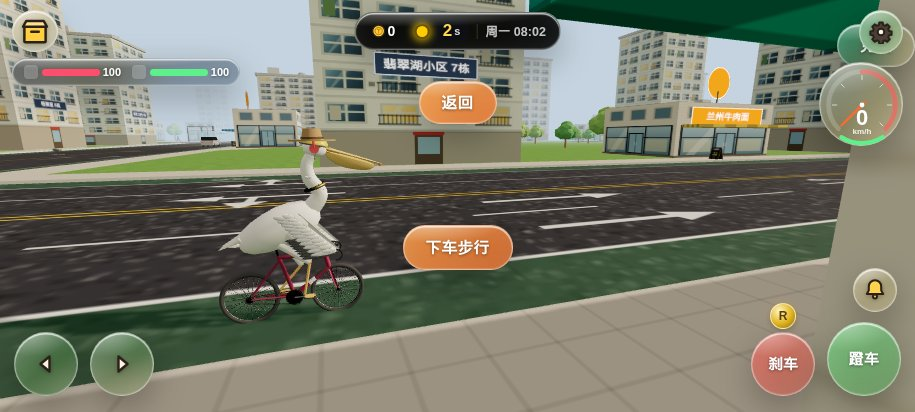
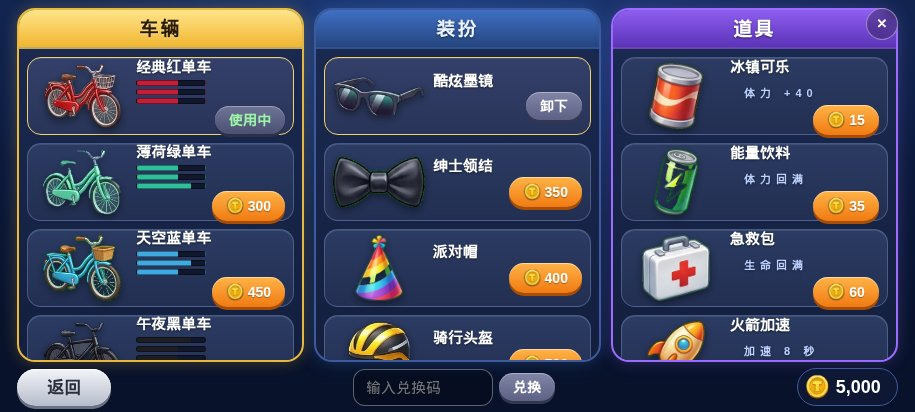
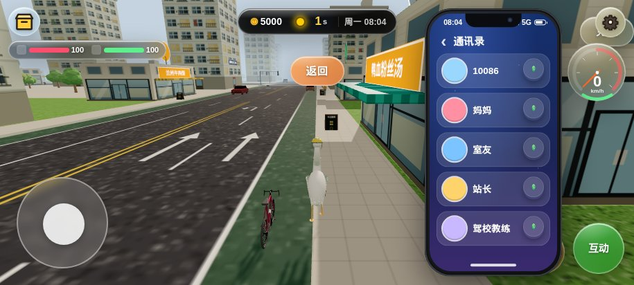
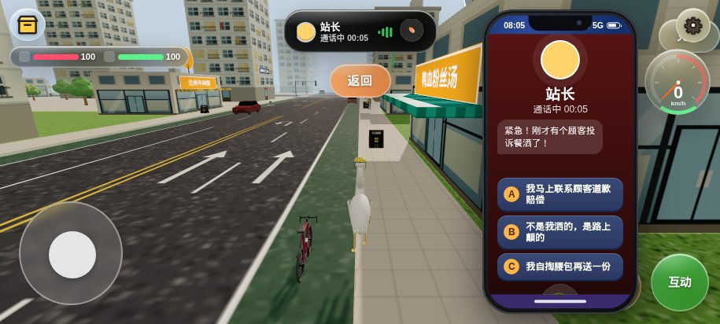
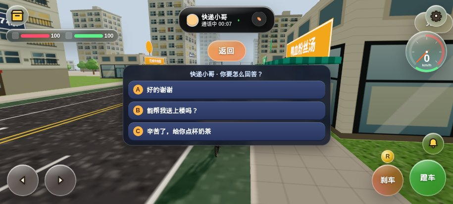
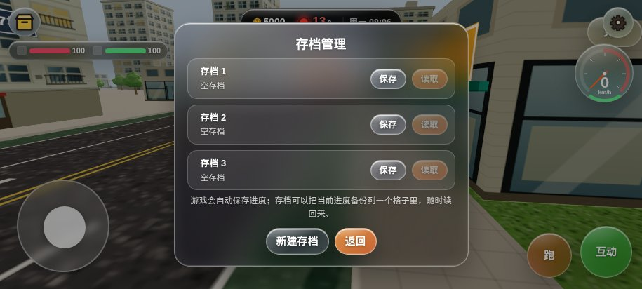

<div align="center">


### 🚲 骑着单车的鹈鹕，在南京街头送外卖

一款用 Three.js 写成的 3D 骑行送外卖小游戏 · 网页 + 安卓双端

> 🚧 **预览版**：当前为 v0.1.9 Preview，尚未发布正式版，玩法和存档格式都可能变动。

[](#-更新日志)
[](https://threejs.org/)
[](#-安卓版)
[](https://hark.site/s/0d49c37e-625c-432c-92bd-f6834056cb3b)



</div>

---

## 📖 简介

你是一只戴着头盔的鹈鹕，骑着一辆小红车在南京的街道上接单、取餐、送餐。
路上要看红绿灯、别逆行、别把汤洒了；手机会响，站长会催，顾客会投诉，路边还有走丢的柯基和追着你跑的熊孩子。

送得越准时，评价越高，金币越多 —— 拿去商店换新车、换帽子，把自己打扮成全城最靓的外卖员。

## ✨ 玩法亮点

| | |
|---|---|
| 🛵 **3D 骑行** | 油门、刹车、转向、变速，第一人称跟随视角，速度表实时显示 |
| 🍜 **接单送餐** | 取餐点 → 小区楼栋，按时送达拿好评，超时、洒餐要挨差评 |
| 🚦 **真实交规** | 红绿灯、逆行、未戴头盔都会罚款扣分，驾照分扣完就得重新考 |
| 📱 **手机系统** | 灵动岛、通讯录、短信、日历、音乐，9 个 App 可用 |
| ☎️ **来电三选一** | 20 通剧情电话，每通 3 种回答，金币、体力、评价各有不同结果 |
| 🗺️ **24 个支线** | 找柯基、捡钱包、追大公鸡、送喜糖、护送迷路小朋友、和闪电骑手竞速…… |
| 🛍️ **商店换装** | 车辆 / 装扮 / 道具三栏，厨师帽、牛仔帽、金链子、火箭加速、免罚金卡 |
| 💾 **存档系统** | 3 个存档槽，随时保存、读取、新建，另有自动保存 |
| 🏙️ **南京风味** | 玄武湖、夫子庙、秦淮、紫金山、中山陵……还有南京知识问答 |

## 📸 截图

<table>
  <tr>
    <td></td>
    <td></td>
  </tr>
  <tr>
    <td align="center">🛍️ 商店：车辆 · 装扮 · 道具</td>
    <td align="center">📱 手机：通讯录与灵动岛</td>
  </tr>
  <tr>
    <td></td>
    <td></td>
  </tr>
  <tr>
    <td align="center">☎️ 来电：三个回答，三种结局</td>
    <td align="center">💬 路人对话</td>
  </tr>
  <tr>
    <td colspan="2"></td>
  </tr>
  <tr>
    <td colspan="2" align="center">💾 存档管理</td>
  </tr>
</table>

## 🎮 操作

| 动作 | 手机 | 键盘 |
|---|---|---|
| 加速 | 右下「蹬车」 | `W` / `↑` |
| 刹车 | 「刹车」 | `S` / `↓` / `空格` |
| 转向 | 左下方向键 / 摇杆 | `A` `D` / `←` `→` |
| 左 / 右转向灯 | — | `Q` / `E` |
| 前进 / 倒车 | 「D / R」档位按钮 | `R` |
| 按铃 | 🔔 | — |
| 下车步行、互动 | 屏幕中间的提示按钮 | — |

## 🚀 快速开始

**直接玩：** 用浏览器打开 [`web/index.html`](web/index.html)（需联网加载 three.js CDN），或者点上面的「在线试玩」。

**改代码后重新打包：**

```bash
# 开发：直接用浏览器打开 web/index.html（多文件引用，改完刷新即看）
# 发布：
cd web
python3 build.py      # 生成 js/config/assets.js，并把 css/ + js/ 打包成 dist/index.html
```

**冒烟测试（每次改动后必跑）：**

```bash
pip install playwright && python -m playwright install chromium
python logs/smoke_test.py
```

## 📱 安卓版

`android/` 是一个极简的 WebView 外壳，游戏页面和 three.js 都放在 `assets/` 里，离线也能玩。

```bash
# 1. 网页改完后同步到安卓
cp web/dist/index.html android/assets/index.html
#    并把其中两处 three.js 的 CDN 地址换成本地的 three.min.js、OrbitControls.js

# 2. 用 Android Studio 打开，或用 aapt2 + d8 + apksigner 打包签名
```

- 包名：`com.gaiqi.pelican`
- 横屏全屏，屏幕常亮，支持存档

## 🗂️ 项目结构

```
pelican-delivery/
├── web/
│   ├── index.html       # ★开发入口★：直接引用 css/ 与 js/，双击即玩
│   ├── build.py         # 打包脚本：生成 js/config/assets.js，打包出 dist/index.html
│   ├── dist/index.html  # 发布单文件（勿手改）
│   ├── js/              # 游戏源码：25 个分层模块（config/core/world/entities/systems/ui + main.js）
│   │   │                # 开发期多 <script> 按序加载；dist 打包时拼进同一个 IIFE（见 task.md §4）
│   │   └── config/assets.js  # 由 build.py 从 assets/ 生成（IMG / ICONSVG / MASC），已提交
│   ├── css/             # 样式：base → glass → phone → ui2 → assets
│   ├── assets/          # 图片素材：imgs.json / icons.json / logo_s.png / mascots/ / vendor/
│   ├── legacy/          # 不参与构建的旧文件（如旧版 music.js）
├── android/
│   ├── AndroidManifest.xml
│   ├── src/com/gaiqi/pelican/MainActivity.java
│   ├── res/             # 图标、应用名
│   └── assets/          # 离线版游戏页面 + three.js
├── docs/                # README 用的截图
└── logs/
    ├── develop.log      # 开发日志：每个版本的改动
    ├── error.log        # 错误日志：历史 bug 与处理
    └── smoke_test.py    # Playwright 冒烟测试
```

## 📝 更新日志

**v0.1.9 Preview**（当前）
- 📞 20 通来电，每通 3 个回答，分支结果各不相同；16 秒不选会随机选择
- 💾 「换个任务重开」改为存档系统：3 个槽位，新建 / 保存 / 读取
- 🗺️ 支线扩充到 24 个，新增支线图鉴进度
- 🛍️ 商店重做为 车辆 / 装扮 / 道具 三栏，新增帽子、耳机、领结、金链、背包和 5 种道具
- 🎨 电话按钮、灵动岛和 9 个 App 图标换新素材

## 🛠️ 技术栈

- [Three.js](https://threejs.org/) r147 · 纯原生 JavaScript，无框架
- 程序化生成城市、道路、建筑与角色模型
- Web Audio 合成音效与音乐
- Android WebView 封装

---

<div align="center">

Made with 🧡 by [GaiQi-NJUST](https://github.com/GaiQi-NJUST) · 南京理工大学

</div>
